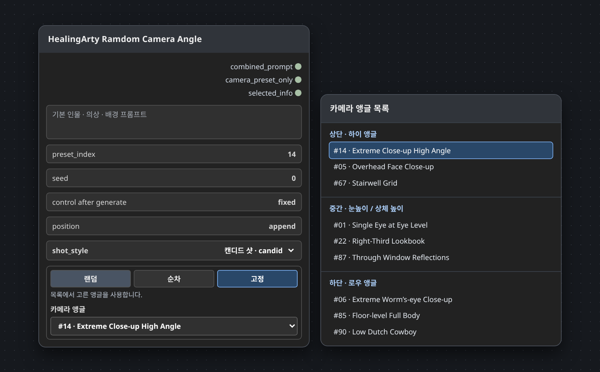

# HealingArty Ramdom Camera Angle

ComfyUI에서 기본 프롬프트에 영어 카메라 프리셋을 붙이는 커스텀 노드입니다. 클로즈업부터 전신 화보와 영화 스틸 구도까지 100개를 랜덤, 순차, 고정 모드로 선택할 수 있습니다.



*노드와 앵글 목록의 미리보기입니다. 실제 화면 배치는 ComfyUI 버전과 테마에 따라 달라질 수 있습니다.*

## 설치

ComfyUI의 `custom_nodes` 폴더에서 실행하세요.

```sh
git clone https://github.com/daning1212/HealingArty-Random-Camera-angle.git
```

ComfyUI를 재시작하고 브라우저를 새로고침하세요. 노드 검색에서 **HealingArty Ramdom Camera Angle**을 선택하세요. 카테고리는 `utils/prompt`이고 추가 Python 패키지는 필요 없습니다.

## 사용 방법

1. `base_prompt`에 인물, 의상, 배경을 입력하세요.
2. **랜덤**, **순차**, **고정** 중 하나를 선택하세요.
3. **카메라 앵글** 목록에서 상단·중간·하단 중 원하는 구도를 고르세요. 선택하면 고정 모드가 자동으로 켜집니다.
4. `shot_style`에서 **카메라 보기**, **다른 곳 보기**, **캔디드 샷**을 선택할 수 있습니다. **지정 안 함**은 카메라 구도만 추가합니다.
5. `position`에서 카메라 문장을 뒤에 붙이는 `append` 또는 앞에 붙이는 `prepend`를 고르세요.
6. `combined_prompt`를 생성 워크플로의 프롬프트 입력에 연결하세요. 인물 레퍼런스 이미지는 기존 이미지 입력에 연결하세요.

| 모드 | 선택 방식 |
| --- | --- |
| 랜덤 | 시드로 구도를 고릅니다. 버튼을 누르면 시드 제어가 `randomize`로 설정됩니다. 재현하려면 시드 제어를 `fixed`로 바꾸고 같은 시드를 사용하세요. |
| 순차 | 버튼을 누르면 시드 제어가 `increment`로 설정됩니다. 시드 0에서 시작하면 01부터 100까지 진행한 뒤 01로 돌아옵니다. 100컷은 큐 실행 횟수를 100으로 지정하세요. |
| 고정 | 카메라 앵글 목록에서 고른 프리셋을 사용합니다. `preset_index`에 번호를 직접 입력할 수도 있습니다. |

| 출력 | 내용 |
| --- | --- |
| `combined_prompt` | 기본 프롬프트와 카메라 문장 |
| `camera_preset_only` | 카메라 문장 |
| `selected_info` | 선택 번호, 이름, 카테고리 |

## 프리셋

| 번호 | 카테고리 |
| --- | --- |
| 01–20 | Editorial & Extreme Close-ups |
| 21–40 | Fashion Magazine Bust & Medium Shots |
| 41–60 | Cowboy & Knee-up Framing |
| 61–80 | Full-Body & Architectural Framing |
| 81–100 | Cinematic & Avant-Garde Angles |

[프리셋 JSON](presets_100.json)에서 샷 크기, 초점거리, 조리개, 앵글, 프레임 배치가 포함된 영어 문장을 확인할 수 있습니다. 내용을 편집한 후 ComfyUI를 재시작하세요.

모드 버튼과 시드 제어는 ComfyUI 위젯을 모사한 환경에서 검사했습니다. 실제 ComfyUI 화면과 모델 생성 결과는 추가 확인이 필요합니다.
